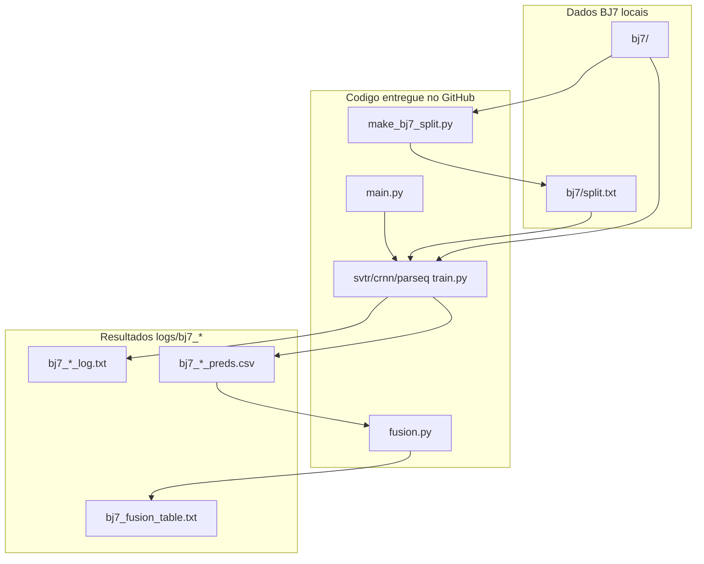

# TCC — OCR de placas veiculares

Repositório do Trabalho de Conclusão de Curso para **reconhecimento óptico de caracteres (OCR)** em placas de veículos. O objetivo é comparar arquiteturas de deep learning em datasets reais e, no caso do BJ7, **fundir predições de múltiplos modelos e múltiplas imagens por veículo** para aumentar a acurácia final.

Este documento cobre o caminho completo: **fundamentação teórica → dados → pré-processamento → treino → avaliação → fusão → artefatos de saída**.

**TCC2:** os mesmos modelos rodam só para inferência numa **Jetson Nano**, com compressão (FP16, INT8, pruning, TensorRT), fusão e ensemble medidos no dispositivo (acurácia, FPS, memória, temperatura e energia). Ver seções [14](#14-inferência-na-jetson-tcc2) a [16](#16-compressão-fusão-na-jetson-e-ensemble-tcc2); resultados finais na seção 16.9.

---

## Entrega de artefatos (BJ7 / ICPR)

**Repositório:** este repositório GitHub.

Escopo desta entrega: experimentos, dados, logs e fusão do dataset **BJ7 (ICPR)**. Todos os arquivos e resultados relevantes estão organizados nos diretórios abaixo.



### Código-fonte e scripts

| Artefato | Função | Parâmetros / como executar |
|----------|--------|----------------------------|
| [`main.py`](main.py) | Orquestrador: treino + teste por modelo (`bj7_svtr`, `bj7_crnn`, `bj7_parseq`) e fusão ao final | Configurar `_DATASETS=["bj7"]` e `_MODELS` no topo do arquivo; parâmetros em `obter_parametros()`. Sem CLI — executar com `python main.py` |
| [`svtr/train.py`](svtr/train.py) | Script de treinamento e avaliação do **SVTR** no BJ7 | Chamado por `main.py`. Entrada: `data_root=bj7/`. Saída: `logs/bj7_svtr/` |
| [`crnn/train.py`](crnn/train.py) | Script de treinamento e avaliação do **CRNN** no BJ7 | Chamado por `main.py`. Entrada: `data_root=bj7/`. Saída: `logs/bj7_crnn/` |
| [`parseq/train.py`](parseq/train.py) | Script de treinamento e avaliação do **PARSeq** no BJ7 | Chamado por `main.py`. Entrada: `data_root=bj7/`. Saída: `logs/bj7_parseq/`. Opções PARSeq em `obter_parametros()` |
| [`make_bj7_split.py`](make_bj7_split.py) | Gera a partição train/val/test em `bj7/split.txt` (80/20, seed 42) | `python make_bj7_split.py` — executar **antes** do treino |
| [`fusion.py`](fusion.py) | Fusão MV e MVCP (intra-modelo e inter-modelos) a partir dos CSVs de teste | `python fusion.py` ou automático ao final de `main.py` |
| [`requirements.txt`](requirements.txt) | Dependências do ambiente Python | `pip install -r requirements.txt` |

**Scripts do TCC2 (inferência na Jetson)** — detalhes nas seções 14 a 16:

| Artefato | Função |
|----------|--------|
| [`crnn/infer.py`](crnn/infer.py), [`svtr/infer.py`](svtr/infer.py), [`parseq/infer.py`](parseq/infer.py) | Inferência standalone (desktop ou Jetson): acurácia, FPS, memória, temperatura, energia e predições num passe só (`--compress`, `--trt-engine`, PARSeq `--parseq-nar`/`--img-h/--img-w`) |
| [`bench.py`](bench.py) | Medição compartilhada: timer, memória, `PowerLogger` (jtop/nvidia-smi), CSV |
| [`compress.py`](compress.py) | FP16, INT8 dinâmico, pruning e carga de motores TensorRT |
| [`prune_model.py`](prune_model.py) | Gera checkpoints podados (`bj7_<modelo>_pruneNN`) |
| [`export_onnx.py`](export_onnx.py) | Exporta os checkpoints para ONNX (opset 13) e valida contra o PyTorch |
| [`build_trt_engines.sh`](build_trt_engines.sh) | Compila os ONNX em motores TensorRT na Jetson (`trtexec`) |
| [`trt_runner.py`](trt_runner.py) | Executa um motor TensorRT com interface de modelo PyTorch |
| [`run_bench_matrix.sh`](run_bench_matrix.sh) | Roda a matriz inteira de benchmarks na Jetson (com `nohup`, espera térmica, retomada) |
| [`report.py`](report.py) | Junta benchmarks + fusão numa tabela acurácia × FPS × energia × tamanho |
| [`sync_jetson.sh`](sync_jetson.sh) | Envia checkpoints, dataset de teste, cache do PARSeq e ONNX para a Jetson (`scp`) |

### Dados e pré-processamento

| Artefato | Função | Observação |
|----------|--------|------------|
| `./bj7/` | Dataset **ICPR (BJ7)** — tracks, imagens HR/LR e `annotations.json` | Não versionado (`.gitignore`); deve ser colocado localmente antes do treino |
| `./bj7/split.txt` | Listagem de tracks por split (`training`, `validation`, `testing`) | Gerado por `make_bj7_split.py`; usado por todos os `BJ7Dataset` |

### Resultados, logs e métricas

| Artefato | Função | Conteúdo |
|----------|--------|----------|
| `./logs/bj7_svtr/` | Saídas do run SVTR no BJ7 | Logs, predições e (localmente) checkpoint |
| `./logs/bj7_crnn/` | Saídas do run CRNN no BJ7 | Idem |
| `./logs/bj7_parseq/` | Saídas do run PARSeq no BJ7 | Idem |
| `./logs/bj7_parseq/bj7_parseq_log.txt` | Log de treino, validação e teste | Épocas, loss, acurácias; linha final com `test_acc` |
| `./logs/bj7_parseq/bj7_parseq_preds.csv` | Predições por imagem no conjunto de teste | 15 000 linhas (3 000 tracks × 5 LR). Colunas: `track_id`, `image_type`, `image_idx`, `gt`, `pred`, `conf_seq`, `conf_chars` |
| `./logs/bj7_fusion_table.txt` | Tabela consolidada de fusão (MV e MVCP) | Acurácias HR/LR por modelo e fusão inter-modelos |
| `./logs/jetson/`, `./logs/jetson_v2/`, `./logs/jetson_v3/`, `./logs/trt/` | Resultados do TCC2 na Jetson | Benchmarks, predições e fusões por rodada — o que usar de cada pasta está na seção 16.9 |

> **Checkpoints** (`logs/bj7_*/*_best.pt`): produzidos durante o treino, mas **não fazem parte desta entrega GitHub** (arquivos grandes, excluídos no `.gitignore`). Para reavaliar com pesos locais, usar `eval_only=True` em `obter_parametros()`.

> **Métricas auxiliares:** não há `results.xlsx`, figuras ou matrizes de confusão. As métricas experimentais estão em `*_log.txt`, `*_preds.csv` e `bj7_fusion_table.txt`.

### Documentação auxiliar

| Artefato | Função |
|----------|--------|
| [`docs/pipeline.md`](docs/pipeline.md) | Diagramas Mermaid e descrição detalhada do pipeline BJ7 |
| [`gerar_pipeline_doc.py`](gerar_pipeline_doc.py) | Regenera `docs/pipeline.md` a partir do código |

### Parâmetros de execução (padrão congelado)

Definidos em `obter_parametros()` dentro de [`main.py`](main.py):

| Parâmetro | Valor | Descrição |
|-----------|-------|-----------|
| `_DATASETS` | `["bj7"]` | Dataset da entrega |
| `_MODELS` | `["svtr", "crnn", "parseq"]` | Modelos a executar (editável) |
| `seed` | `42` | Semente global |
| `batch_size` | `64` | Tamanho do batch |
| `epochs` | `30` | Épocas máximas |
| `learning_rate` | `0.0005` | Taxa de aprendizado |
| `min_epochs` | `10` | Warmup antes de scheduler/early stop |
| `lr_patience` | `3` | Épocas sem melhora para reduzir LR |
| `lr_factor` | `0.1` | Fator de redução do LR |
| `early_stop_patience` | `3` | Épocas após redução de LR até parar |
| `warp_w × warp_h` | `256 × 64` | Entrada SVTR/CRNN no BJ7 |
| `parseq_variant` | `parseq_tiny` | Variante PARSeq (~6M parâmetros) |
| `parseq_pretrained` | `False` | Treino do zero (sem pesos pré-treinados) |
| `parseq_decode_ar` | `True` | Decodificação autoregressiva |
| `parseq_refine_iters` | `1` | Iterações de refinamento PARSeq |

**Comando de execução completa:**

```bash
python make_bj7_split.py   # uma vez, antes do treino
python main.py             # treina, avalia e gera fusão
```

Decisões experimentais adicionais: ver [seção 12](#12-decisões-experimentais-congeladas).

---

## Sumário

0. [Entrega de artefatos (BJ7 / ICPR)](#entrega-de-artefatos-bj7--icpr)
1. [Contexto e objetivo](#1-contexto-e-objetivo)
2. [Fundamentação teórica](#2-fundamentação-teórica)
3. [Visão geral do pipeline](#3-visão-geral-do-pipeline)
4. [Datasets](#4-datasets)
5. [Pré-processamento e splits](#5-pré-processamento-e-splits)
6. [Modelos implementados](#6-modelos-implementados)
7. [Treino e avaliação](#7-treino-e-avaliação)
8. [Fusão de predições (BJ7)](#8-fusão-de-predições-bj7)
9. [Saídas e artefatos](#9-saídas-e-artefatos)
10. [Como executar](#10-como-executar)
11. [Estrutura do repositório](#11-estrutura-do-repositório)
12. [Decisões experimentais congeladas](#12-decisões-experimentais-congeladas)
13. [Documentação complementar](#13-documentação-complementar)
14. [Inferência na Jetson (TCC2)](#14-inferência-na-jetson-tcc2)
15. [Referência de comandos (CRNN/SVTR/PARSeq)](#15-referência-de-comandos-crnnsvtrparseq)
16. [Compressão, fusão na Jetson e ensemble (TCC2)](#16-compressão-fusão-na-jetson-e-ensemble-tcc2) — 16.1 esperado × medido · 16.6 resolução do PARSeq · 16.7 TensorRT · 16.8 fluxo de execução · **16.9 resultados finais**

---

## 1. Contexto e objetivo

### Problema

Em sistemas de **ALPR** (Automatic License Plate Recognition), após detectar e recortar a placa na imagem, é necessário **ler a sequência alfanumérica** (ex.: `ABC1D23`). Isso é um problema de **reconhecimento de texto em cena** (*scene text recognition*), com particularidades:

- Comprimento variável (7 caracteres no padrão Mercosul, 7 no antigo brasileiro, etc.).
- Degradação por blur, oclusão, inclinação e baixa resolução.
- Vocabulário fechado: apenas `A–Z` e `0–9`.

### Objetivo deste repositório

1. Treinar e avaliar **três arquiteturas** (SVTR, CRNN, PARSeq) de forma **isolada** — cada modelo tem pesos, logs e predições próprios.
2. No dataset **BJ7**, explorar **fusão pós-processamento**: combinar as 5 imagens HR e 5 LR de cada *track* (veículo) e, depois, combinar os três modelos.
3. Manter **reprodutibilidade**: seeds fixas, splits versionados, protocolo documentado.

### Escopo atual

| Item | Situação |
|------|----------|
| Dataset **BJ7** (ICPR) | Ativo — treino, avaliação e fusão |
| Dataset **RodoSol** | Suportado no código; ativar em `main.py` |
| Modelos | `svtr`, `crnn`, `parseq` implementados |
| Fusão | Apenas BJ7 (`fusion.py`) |

---

## 2. Fundamentação teórica

### 2.1 OCR de placas como sequência

Dada uma imagem recortada da placa \( I \), o modelo estima uma sequência de caracteres \( \hat{y} = (\hat{y}_1, \ldots, \hat{y}_L) \) que deve coincidir com o ground truth \( y \) após normalização.

**Métrica principal adotada:** *acurácia em nível de placa* — a predição normalizada deve ser **idêntica** ao rótulo (100% dos caracteres corretos). Não usamos CER (Character Error Rate) como métrica oficial nesta fase.

### 2.2 Normalização do texto

Tanto ground truth quanto predições passam pela mesma regra:

- Converter para **maiúsculas**.
- Manter **somente** caracteres alfanuméricos (`A–Z`, `0–9`).
- Remover hífens, pontos, espaços e outros símbolos.

Implementação: `_sanitize_plate()` nos módulos `dataset.py`.

### 2.3 CTC (Connectionist Temporal Classification)

Usado por **SVTR** e **CRNN**.

- A rede emite uma sequência de logits ao longo do eixo horizontal da imagem (eixo temporal \( T \)).
- Um símbolo especial **blank** permite alinhar comprimentos diferentes entre imagem e texto.
- Na inferência, aplica-se decodificação **greedy**: argmax por timestep, removendo blanks e repetições consecutivas.

**Confiança por caractere (CTC):** probabilidade softmax no timestep em que cada caractere foi emitido.  
**Confiança da sequência (`conf_seq`):** média geométrica das confianças por caractere.

### 2.4 PARSeq (Permutation Autoregressive Sequence)

Arquitetura **transformer** com decodificação autoregressiva (via `torch.hub`, repositório `baudm/parseq`).

- Não usa CTC; o modelo prediz tokens de forma sequencial.
- Pode ser instanciado **do zero** (`parseq_pretrained=False`) ou com pesos pré-treinados em scene-text genérico (`parseq_pretrained=True`).
- Duas variantes de entrada: **32×128** px (resolução nativa da arquitetura, run `bj7_parseq_legado`) e **64×256** px (mesma do SVTR/CRNN, run `bj7_parseq`) — comparadas na seção 16.6.
- Treino com o mesmo **augmentation** leve dos outros dois modelos (ColorJitter, RandomAffine, GaussianBlur — `make_transform_train` nos três `dataset.py`).
- Early stopping monitora **char_acc** (acurácia posicional por caractere), não apenas match exato da placa.

### 2.5 Fusão por voto ponderado

No BJ7, cada *track* gera **10 predições** (5 HR + 5 LR). A fusão combina essas predições (e depois combina modelos) usando dois esquemas:

| Estratégia | Nome | Ideia |
|------------|------|-------|
| **MV** | Voto Majoritário por sequência | Cada imagem vota na **string inteira**; peso = `conf_seq`. |
| **MVCP** | Voto Majoritário por Caractere/Posição | Para cada posição \( i \), vota-se o caractere na posição \( i \) de cada predição; peso = `conf_chars[i]`. |

Em ambos os casos, o vencedor é quem acumula **maior soma de pesos** (empate → primeira ocorrência vence).

**Fusão intra-modelo:** dentro de um mesmo modelo, separando HR e LR.  
**Fusão inter-modelos:** cada modelo produz **1 voto** por track (HR+LR combinados); depois vota-se entre os modelos.

---

## 3. Visão geral do pipeline

```
┌─────────────────────────────────────────────────────────────────────────────┐
│  DADOS                                                                      │
│  bj7/ (tracks + annotations)          rodosol/ (cenas + labels)             │
└───────────────┬─────────────────────────────────────┬───────────────────────┘
                │                                     │
                ▼                                     ▼
┌───────────────────────┐                 ┌───────────────────────┐
│ make_bj7_split.py     │                 │ crop_rodosol.py       │
│ → bj7/split.txt       │                 │ → rodosol/crops/      │
└───────────┬───────────┘                 └───────────┬───────────┘
            │                                         │
            └─────────────────┬───────────────────────┘
                              ▼
┌─────────────────────────────────────────────────────────────────────────────┐
│  main.py  →  loop (modelo × dataset)  →  svtr | crnn | parseq train.py    │
│              treino → checkpoint → avaliação teste → CSV de predições       │
└─────────────────────────────────────────────────────────────────────────────┘
                              │
                              ▼ (somente BJ7)
┌─────────────────────────────────────────────────────────────────────────────┐
│  fusion.py  →  lê CSVs  →  fusão MV + MVCP  →  bj7_fusion_table.txt         │
└─────────────────────────────────────────────────────────────────────────────┘
```

Diagramas detalhados com Mermaid: [`docs/pipeline.md`](docs/pipeline.md) (gerado por `gerar_pipeline_doc.py`).

---

## 4. Datasets

### 4.1 BJ7 (`bj7/`) — dataset ICPR

**BJ7 é o mesmo dataset ICPR** (competição/desafio de reconhecimento de placas). Neste repositório ele fica na pasta `bj7/` por conveniência de caminho e nomenclatura dos runs (`bj7_svtr`, etc.), mas os dados, estrutura e protocolo são os do ICPR.

Dataset **real** (LRLPR-26, da competição *ICPR 2026 Competition on Low-Resolution License Plate Recognition*) organizado em **tracks** (sequências de um mesmo veículo). Cada track contém múltiplas capturas HR e LR da mesma placa.

#### Estrutura de diretórios

```
bj7/
├── train/
│   ├── Scenario-A/
│   │   ├── Brazilian/track_XXXXX/
│   │   └── Mercosur/track_XXXXX/
│   └── Scenario-B/
│       ├── Brazilian/track_XXXXX/
│       └── Mercosur/track_XXXXX/
├── test/
│   └── track_XXXXX/
└── split.txt                    ← gerado por make_bj7_split.py
```

#### Conteúdo de cada track

| Arquivo | Descrição |
|---------|-----------|
| `annotations.json` | `plate_text` (GT), `plate_layout`, metadados |
| `hr-001..005.{png\|jpg}` | 5 imagens **alta resolução** (treino/val apenas) |
| `lr-001..005.{png\|jpg}` | 5 imagens **baixa resolução** (todos os splits) |

**Extensão automática:** Scenario-A usa PNG; Scenario-B e teste usam JPG. O `BJ7Dataset` detecta via presença de `hr-001.png`.

#### Contagens aproximadas

| Split | Tracks | Imagens (aprox.) |
|-------|--------|------------------|
| training | 16 000 | 160 000 (10 img/track) |
| validation | 4 000 | 40 000 |
| testing | 3 000 | 15 000 (somente LR) |

O conjunto de **teste oficial não possui imagens HR** — por isso a fusão HR no teste reporta acurácia 0 (não há amostras HR para fundir).

#### Layouts

- **Brazilian** (padrão antigo) e **Mercosur** coexistem no treino.
- Um único modelo por dataset aprende **ambos** os layouts; comprimentos variam conforme o rótulo.

---

### 4.2 RodoSol-ALPR (`rodosol/`)

Dataset real de cenas 1280×720 com anotações por imagem.

#### Estrutura esperada

```
rodosol/
├── split.txt
├── images/
│   ├── cars-br/
│   ├── cars-me/
│   ├── motorcycles-br/
│   └── motorcycles-me/
│       └── img_XXXXXX.jpg + img_XXXXXX.txt
└── crops/                       ← gerado por crop_rodosol.py
    └── {categoria}/img_XXXXXX.jpg
```

#### Arquivo de label (`.txt`)

Campos relevantes:

- `plate:` texto da placa
- `layout:` Brazilian ou Mercosur
- `corners:` quatro pontos `x,y` separados por espaço

**Ordem dos corners (congelada):** top-left → top-right → bottom-right → bottom-left (sentido horário).

#### Pré-processamento

`crop_rodosol.py` aplica **homografia** (perspectiva) nos quatro corners e gera crops **256×64** px em `rodosol/crops/`. Não há redimensionamento extra após o warp — essa é a entrada dos modelos CTC (SVTR/CRNN).

---

## 5. Pré-processamento e splits

### 5.1 Gerar split do BJ7

```bash
python make_bj7_split.py
```

**Regras (`make_bj7_split.py`):**

- **Seed:** 42
- **Treino interno:** 80% training / 20% validation, **estratificado** por grupo `(Scenario, Categoria)` — ou seja, dentro de cada pasta `Scenario-A/Brazilian`, etc., 80% das tracks vão para training e 20% para validation.
- **Teste:** todas as tracks em `bj7/test/` → split `testing`
- **Saída:** `bj7/split.txt`, uma linha por track:

```
./train/Scenario-A/Brazilian/track_01384;training
./test/track_10002;testing
```

> **Atenção — divisão por track, não por placa.** No Scenario-A a mesma placa aparece em várias tracks, então 843 das 4 000 tracks de validação (21%) têm uma placa que também está no treino: a validação (usada para escolher o checkpoint) fica otimista. O **teste não tem essa sobreposição** (1 placa em 3 000 aparece no treino/validação), então os resultados de teste valem. Corrigir exigiria refazer o split por placa e retreinar.

### 5.2 Gerar crops do RodoSol

```bash
python crop_rodosol.py
```

Processa em paralelo todas as imagens de `rodosol/images/` e grava warps 256×64 em `rodosol/crops/`.

### 5.3 Como o DataLoader consome o split

`BJ7Dataset` e `RodoSolDataset` (em `svtr/dataset.py`, `crnn/dataset.py`, `parseq/dataset.py`):

1. Leem `split.txt`.
2. Filtram linhas pelo split desejado (`training`, `validation`, `testing`).
3. Expandem cada track BJ7 em **10 amostras** independentes (hr-001..005 + lr-001..005).
4. Aplicam transformação de imagem (resize + normalização ImageNet).

No treino BJ7, HR e LR são **misturados** como amostras i.i.d. — o modelo não distingue resolução durante o aprendizado.

---

## 6. Modelos implementados

### 6.1 SVTR-Tiny (`svtr/`)

- **Paper:** Du et al., *SVTR: Scene Text Recognition with a Single Visual Model* (2022).
- **Mecanismo:** Transformer híbrido (mixers locais + globais) + cabeça **CTC**.
- **Entrada:** 256×64 px.
- **Configuração:** 3 estágios (dimensões 64/128/256, profundidades 3/6/3, cabeças 2/4/8).
- **Parâmetros:** ~3,7M (contados no checkpoint).
- **Treino:** Adam, CTCLoss, monitoramento por `val_acc` (acurácia de placa).

### 6.2 CRNN (`crnn/`)

- **Paper:** Shi et al., *An End-to-End Trainable Neural Network for Image-based Sequence Recognition* (2015).
- **Mecanismo:** CNN + BiLSTM × 2 (256 unidades por direção) + **CTC**.
- **Entrada:** 256×64 px.
- **Parâmetros:** ~7,7M.
- **Baseline clássico** para comparação com arquiteturas mais recentes.

### 6.3 PARSeq-Tiny (`parseq/`)

- **Paper:** Bautista & Atienza, *Scene Text Recognition with Permuted Autoregressive Sequence Models* (ECCV 2022).
- **Mecanismo:** Transformer autoregressivo via `torch.hub.load("baudm/parseq", ...)`.
- **Entrada:** 32×128 px (`bj7_parseq_legado`, nativa) ou 64×256 px (`bj7_parseq`, retreinado) — `--img-h/--img-w` no `infer.py`.
- **Variante padrão:** `parseq_tiny` (~6,0M parâmetros; 6,1M em 64×256, pelo `pos_embed` maior).
- **Treino:** AdamW, loss nativa do PARSeq, early stopping por `char_acc`.

### 6.4 Vocabulário compartilhado (CTC)

```
blank = 0
'0'–'9' = 1–10
'A'–'Z' = 11–36
Total: 37 classes
```

PARSeq usa o tokenizer próprio do hub (charset compatível com alfanuméricos).

### 6.5 Matriz de experimentos

Cada combinação `dataset × modelo` é um **run** independente:

| Run | Dataset | Modelo |
|-----|---------|--------|
| `bj7_svtr` | BJ7 | SVTR |
| `bj7_crnn` | BJ7 | CRNN |
| `bj7_parseq` | BJ7 | PARSeq |
| `rodosol_svtr` | RodoSol | SVTR |
| `rodosol_crnn` | RodoSol | CRNN |
| `rodosol_parseq` | RodoSol | PARSeq |

Nomes de pasta e arquivos seguem `{dataset}_{modelo}`.

---

## 7. Treino e avaliação

### 7.1 Orquestração (`main.py`)

- **Entrada:** `python main.py` (sem CLI; parâmetros em `obter_parametros()`).
- Loop aninhado: `_MODELS × _DATASETS`.
- Se um run falhar, os demais continuam; ao final imprime resumo de status.
- Se `bj7` estiver nos datasets, executa `fusion.run_fusion()` automaticamente.

**Configuração atual (editável no topo de `main.py`):**

```python
_DATASETS = ["bj7"]
_MODELS = ["parseq"]   # opções: "svtr", "crnn", "parseq"
```

### 7.2 Hiperparâmetros padrão (`obter_parametros`)

| Parâmetro | Valor | Descrição |
|-----------|-------|-----------|
| `seed` | 42 | Reprodutibilidade |
| `batch_size` | 64 | Tamanho do batch |
| `epochs` | 30 | Épocas máximas |
| `learning_rate` | 5e-4 | LR inicial |
| `min_epochs` | 10 | Warmup antes de scheduler/early stop |
| `lr_patience` | 3 | Épocas sem melhora para reduzir LR |
| `lr_factor` | 0.1 | Fator de redução do LR (1×) |
| `early_stop_patience` | 3 | Épocas após redução de LR até parar |
| `warp_w × warp_h` | 256×64 | Entrada SVTR/CRNN/RodoSol |
| `parseq_variant` | `parseq_tiny` | Variante PARSeq |
| `parseq_pretrained` | `False` | Treino do zero (comparável ao SVTR) |

> **Nota:** o PARSeq costuma precisar de schedule mais longo em treinos do zero. Se a convergência for lenta, aumente `epochs`, `min_epochs`, `lr_patience` e `early_stop_patience` em `obter_parametros()`. Detalhes em [`docs/pipeline.md`](docs/pipeline.md).

### 7.3 Ciclo de treino (comum)

1. Carregar datasets train / val / test via `split.txt`.
2. Loop de épocas: forward → loss → backward (clip grad = 5.0).
3. Avaliar no validation a cada época.
4. Salvar melhor checkpoint (`{run_name}_best.pt`) quando a métrica de validação melhora.
5. **Scheduler em duas fases:**
   - Após `min_epochs`, se não houver melhora por `lr_patience` épocas → reduz LR uma vez.
   - Se ainda não houver melhora por `early_stop_patience` épocas → early stop.
6. Recarregar melhor checkpoint e avaliar no **teste**.
7. (BJ7) Gerar CSV de predições por imagem.

### 7.4 Métricas

| Métrica | Onde | Definição |
|---------|------|-----------|
| `val_acc` / `seq_acc` | Validação e teste | % placas com match exato pós-normalização |
| `char_acc` | PARSeq | % caracteres corretos posição a posição |
| Fusão HR/LR/inter | `fusion.py` | Acurácia por track após voto ponderado |

---

## 8. Fusão de predições (BJ7)

Implementada em `fusion.py`. Executada automaticamente ao final de `main.py` (ou manualmente: `python fusion.py`).

### 8.1 Entrada: CSV por modelo

Cada modelo gera `logs/bj7_{modelo}/bj7_{modelo}_preds.csv` com **uma linha por imagem**:

| Coluna | Exemplo | Significado |
|--------|---------|-------------|
| `track_id` | `track_10002` | Identificador da track |
| `image_type` | `lr` ou `hr` | Resolução |
| `image_idx` | `1..5` | Índice dentro do tipo |
| `gt` | `AQE0422` | Ground truth normalizado |
| `pred` | `AQE0422` | Predição do modelo |
| `conf_seq` | `0.978110` | Confiança da sequência (média geométrica) |
| `conf_chars` | `0.9982\|0.9149\|...` | Confiança por caractere |

**Camada de desacoplamento:** a fusão lê **somente os CSVs**. Você pode alterar `fusion.py` ou reprocessar fusões **sem retreinar** modelos.

### 8.2 Fusão intra-modelo (por track)

Para cada modelo e cada track:

```
HR fusion:  weighted_vote nas 5 predições HR  → acerta se vencedor == gt
LR fusion:  weighted_vote nas 5 predições LR  → acerta se vencedor == gt
```

Mesma lógica para MV e MVCP (com pesos diferentes).

### 8.3 Fusão inter-modelos

Para cada track:

1. Cada modelo agrega suas 10 imagens (HR+LR) em **1 voto** (`_combined_track_mv` ou `_combined_track_mvcp`).
2. Voto final entre modelos via `weighted_vote`, peso = confiança acumulada do voto vencedor de cada modelo.
3. Acurácia calculada apenas nas tracks presentes em **todos** os CSVs disponíveis.

### 8.4 Onde HR e LR se misturam

| Etapa | HR isolado | LR isolado | HR+LR misturados |
|-------|:----------:|:----------:|:----------------:|
| Treino | — | — | ✓ (amostras independentes) |
| Dump CSV | — | — | ✓ (coluna `image_type`) |
| Fusão intra HR/LR | ✓ / ✓ | ✓ / ✓ | ✗ |
| Fusão inter-modelos | — | — | ✓ (1 voto por modelo) |

### 8.5 Saída: tabela de fusão

Arquivo: `logs/bj7_fusion_table.txt`

Contém duas seções (MV e MVCP), cada uma com:

- Acurácia HR fusion, LR fusion e número de tracks **por modelo**.
- Acurácia da **fusão inter-modelos** (requer ≥ 2 CSVs).

Exemplo de leitura:

```
== MV (Voto Majoritario por sequencia, peso = conf_seq) ==
Modelo   | HR fusion | LR fusion | Tracks
parseq   |   0.0000  |   0.6827  |  3000
Fusao inter-modelos: Acuracia por track: 0.7127 (3000 tracks)
```

HR fusion = 0 no teste porque **não existem imagens HR** no split `testing`.

---

## 9. Saídas e artefatos

Resumo técnico detalhado. Para o índice de entrega ao professor (escopo BJ7/ICPR), ver [Entrega de artefatos](#entrega-de-artefatos-bj7--icpr).

Por run (`logs/{dataset}_{modelo}/`):

| Arquivo | Conteúdo |
|---------|----------|
| `{run}_best.pt` | Pesos do melhor checkpoint (validação) |
| `{run}_log.txt` | Histórico época a época (loss, métricas val; linha final com teste) |
| `{run}_preds.csv` | Predições detalhadas no teste (**somente BJ7**) |

Global (BJ7):

| Arquivo | Conteúdo |
|---------|----------|
| `logs/bj7_fusion_table.txt` | Tabela MV + MVCP, intra e inter modelos |

### Formato do log (SVTR/CRNN)

```csv
epoch,train_loss,val_acc
...
test_acc,0.654321
```

### Formato do log (PARSeq)

```csv
epoch,train_loss,val_seq_acc,val_char_acc
...
test_acc,0.682700,0.912345
```

---

## 10. Como executar

### 10.1 Ambiente

```bash
pip install -r requirements.txt
```

Dependências principais: PyTorch, torchvision, OpenCV, timm, Pillow.

GPU CUDA recomendada; o código faz fallback para MPS (Apple Silicon) ou CPU.

### 10.2 Preparar dados (primeira vez)

```bash
# BJ7: colocar dataset em bj7/ e gerar split
python make_bj7_split.py

# RodoSol (opcional): colocar dataset em rodosol/ e gerar crops
python crop_rodosol.py
```

### 10.3 Treinar e avaliar

1. Editar `_MODELS` e `_DATASETS` em `main.py`.
2. Ajustar hiperparâmetros em `obter_parametros()` se necessário.
3. Executar:

```bash
python main.py
```

### 10.4 Só fusão (sem retreinar)

```bash
python fusion.py
```

Lê CSVs existentes em `logs/bj7_*/` e regenera `bj7_fusion_table.txt`.

### 10.5 Só avaliação (checkpoint existente)

Em `obter_parametros()`, definir:

```python
eval_only = True
resume = None  # usa {run}_best.pt já salvo em out_dir
```

---

## 11. Estrutura do repositório

```
ml/
├── main.py                 # Orquestrador: loop modelo×dataset + fusão BJ7
├── make_bj7_split.py       # Gera bj7/split.txt
├── crop_rodosol.py         # Warp RodoSol → crops 256×64
├── fusion.py               # Fusão MV/MVCP intra e inter modelos
├── gerar_pipeline_doc.py   # Regenera docs/pipeline.md
├── requirements.txt
│
├── svtr/                   # SVTR-Tiny + CTC
│   ├── model.py
│   ├── dataset.py
│   └── train.py
├── crnn/                   # CRNN + CTC
│   ├── model.py
│   ├── dataset.py
│   └── train.py
├── parseq/                 # PARSeq via torch.hub
│   ├── model.py
│   ├── dataset.py
│   └── train.py
│
├── bj7/                    # Dataset BJ7 (não versionado)
├── rodosol/                # Dataset RodoSol (não versionado)
│
├── logs/                   # Saídas dos experimentos
│   ├── bj7_svtr/
│   ├── bj7_crnn/
│   ├── bj7_parseq/
│   └── bj7_fusion_table.txt
│
└── docs/
    ├── pipeline.md         # Diagramas Mermaid do pipeline
    └── pipeline.html
```

---

## 12. Decisões experimentais congeladas

Alterar qualquer item abaixo implica **nova bateria de experimentos** documentada.

| Tema | Decisão |
|------|---------|
| Seed global | `42` (`random`, `numpy`, `torch`) |
| Split BJ7 | Seed `42`; 80/20 train/val estratificado por `(Scenario, Categoria)`; teste = pasta `bj7/test/` |
| Imagens por track (BJ7) | Todas `hr-*` e `lr-*` do track entram no split correspondente |
| Warp RodoSol | Homografia → **256×64** px; corners TL→TR→BR→BL |
| Normalização texto | Maiúsculas; só `A–Z` e `0–9` |
| Charset modelo | `A–Z`, `0–9` (+ blank para CTC) |
| Métrica principal | Acurácia de placa (match exato) |
| Fusão BJ7 | MV e MVCP ponderados por confiança |
| Isolamento de modelos | Treino, checkpoint e CSV separados; fusão só em pós-processamento |

---

## 13. Documentação complementar

- **[`docs/pipeline.md`](docs/pipeline.md)** — diagramas Mermaid, contagens de amostras, detalhes de scheduler PARSeq vs CTC, exemplos numéricos de voto ponderado. Regenerar com `python gerar_pipeline_doc.py`.
- **`docs/pipeline.html`** — mesma documentação em HTML.

---

## 14. Inferência na Jetson (TCC2)

> Início do **TCC2**: portar o pipeline para um dispositivo embarcado (Jetson Nano) e comparar acurácia, FPS, memória, temperatura e energia contra o desktop. **Treino continua só no desktop** (RTX 4060); a Jetson roda **só inferência** (com e sem compressão dos modelos). Os 3 modelos (CRNN, SVTR, PARSeq) têm `infer.py` portado e validado nas duas plataformas; compressão, TensorRT, fusão na Jetson e resultados finais estão na [seção 16](#16-compressão-fusão-na-jetson-e-ensemble-tcc2).

### 14.1 Hardware

| | Desktop | Jetson |
|---|---|---|
| Papel | Treino dos 3 modelos | Só inferência (com/sem compressão) |
| Equipamento | AMD Ryzen 7 5700X, 16GB RAM, NVIDIA RTX 4060 (8GB) | Seeed reComputer J1020 v2, módulo Jetson Nano 4GB (P3448): ARM Cortex-A57 4 núcleos @ 1,43GHz, GPU Maxwell 128 núcleos CUDA, 4GB compartilhados CPU/GPU |
| Sistema | — | JetPack 4.6.6 (L4T R32.7.6) |
| Armazenamento do projeto | disco local | SSD NVMe 256GB em `/mnt/ssd` (eMMC de 16GB tem só o SO — não usar pra dados/modelos) |

### 14.2 Ambiente Python na Jetson

Projeto em `/mnt/ssd/projeto-tcc2/tcc-placa-ocr`, venv em `/mnt/ssd/projeto-tcc2/venv` (**Python 3.6.9**, com `include-system-site-packages = true` para acessar o OpenCV do sistema).

Versões instaladas manualmente (não usar `pip install -U` nelas):

| Pacote | Versão | Motivo |
|---|---|---|
| PyTorch | 1.10.0 | wheel pré-compilada NVIDIA p/ JetPack 4.6.6 + CUDA 10.2 |
| torchvision | 0.11.1 | compilado do fonte (compatível com o PyTorch acima) |
| numpy | 1.19.5 | única com wheel pronta pra aarch64 + Python 3.6 |
| Pillow | 8.4.0 | última compatível com Python 3.6 |
| OpenCV | (do sistema, via JetPack) | `opencv-python` do PyPI não compila no Ubuntu 18.04 (CMake antigo) |

Por isso, em `requirements.txt`, as linhas de `opencv-python`, `torch`, `torchvision` e `numpy` ficam comentadas — essas quatro são instaladas manualmente nas versões acima; o resto vai por `pip3 install -r requirements.txt` normalmente.

**Sempre exportar antes de rodar qualquer script:**
```bash
export OPENBLAS_CORETYPE=ARMV8
```
Sem isso, numpy/torch dão `Illegal instruction (core dumped)` (bug do OpenBLAS com a CPU Cortex-A57). Já está em `~/.bashrc`, mas confirme em sessões/scripts novos.

**Nunca `sudo pip3`/`pip` dentro do venv** — ignora o ambiente virtual e instala no Python do sistema, causando `ModuleNotFoundError` mesmo com o venv "ativo".

### 14.3 Compatibilidade Python 3.6

O restante do repositório foi escrito assumindo Python 3.9+ (`from __future__ import annotations`, `list[str]`, `X | None`, `str.removeprefix`) — nada disso roda no Python 3.6.9 da Jetson (nem o `from __future__ import annotations`, que só existe a partir do 3.7). Essas construções já foram convertidas para `typing.List/Optional/Tuple` e um helper `_strip_prefix` (substitui `str.removeprefix`), compatível com 3.6 **e** com o Python do desktop ao mesmo tempo, nos **3 modelos**:

- `bench.py`
- `crnn/model.py`, `crnn/dataset.py`, `crnn/train.py`, `crnn/infer.py`
- `svtr/model.py`, `svtr/dataset.py`, `svtr/train.py`, `svtr/infer.py`
- `parseq/model.py`, `parseq/dataset.py`, `parseq/train.py`, `parseq/infer.py`

**PARSeq tem um problema à parte:** ele carrega um pacote de terceiros (`strhub`, via `torch.hub.load("baudm/parseq", ...)`, cacheado em `~/.cache/torch/hub/baudm_parseq_main/`) que se declara oficialmente `requires-python = ">=3.9"` no seu `pyproject.toml`. Mesmo com o nosso código 100% corrigido, o import do `strhub` quebrava em Python 3.6 antes de qualquer inferência rodar (`EPOCH_OUTPUT = list[dict[str, BatchResult]]` é uma atribuição real, não anotação — levanta `TypeError` na importação do módulo, independente de future-import).

Investigação de escopo (`_get_model_class` em `strhub/models/utils.py` faz import condicional por variante — `abinet`/`crnn`/`trba`/`vitstr` do `strhub` nunca são tocados ao carregar `parseq`/`parseq_tiny`) reduziu o patch necessário a exatamente **2 arquivos** do cache, já corrigidos no desktop com a mesma técnica `typing`:

- `strhub/models/base.py`: `EPOCH_OUTPUT`, `forward_logits_loss` (×3, incluindo subclasses `CrossEntropySystem`/`CTCSystem`) e `_aggregate_results`.
- `strhub/data/utils.py`: `_tok2ids`, `_ids2tok`, `encode` (×2), `_filter` (×2), `decode`, nas classes `BaseTokenizer`, `Tokenizer` e `CTCTokenizer`.

O `from dataclasses import dataclass` de `strhub/models/base.py` foi mantido como está — resolve-se instalando o backport oficial na Jetson, não editando o arquivo:
```bash
pip3 install dataclasses   # backport pra Python 3.6; no-op/desnecessário em 3.7+
```

Esse patch vive só no cache local do desktop (não é parte do repositório git — é código de terceiros baixado pelo `torch.hub`). Ele é reenviado pra Jetson via `sync_jetson.sh hubcache` (seção 14.4), o que também evita a Jetson precisar baixar/importar sozinha a versão não-patchada. Se o cache do hub for limpo ou atualizado, o patch precisa ser reaplicado antes de reenviar.

### 14.4 Transferir código e artefatos

O código vai por `git pull` normalmente. Checkpoints (`.pt`) e o dataset **não** — `.gitignore` exclui `logs/**/*.pt` e `bj7/` (exceto `bj7/split.txt`, que é leve e vai commitado). Motivo: git não faz diff de binário, então cada retreino viraria um blob novo permanente no histórico, e o GitHub tem limite de 100MB por arquivo.

Em vez disso, use [`sync_jetson.sh`](sync_jetson.sh) do desktop, via `scp`/`ssh` direto:

```bash
export JETSON_HOST=pedrobastos@<ip-ou-hostname-da-jetson>

./sync_jetson.sh testset                        # bj7/split.txt + bj7/test/ (~75MB, já é só o split de teste)
./sync_jetson.sh hubcache                       # cache do torch.hub do PARSeq (strhub já patchado p/ Python 3.6, ~1MB)
./sync_jetson.sh ckpt bj7_crnn bj7_svtr bj7_parseq   # checkpoints treinados no desktop
./sync_jetson.sh all bj7_crnn bj7_svtr bj7_parseq    # testset + hubcache + os 3 checkpoints de uma vez
```

Na Jetson, atualizar o código:
```bash
cd /mnt/ssd/projeto-tcc2/tcc-placa-ocr
git pull
```

### 14.5 Rodar inferência (CRNN, SVTR, PARSeq)

`crnn/infer.py`, `svtr/infer.py` e `parseq/infer.py` são standalone e seguem a mesma CLI — carregam só o checkpoint + split pedido (não montam `ds_train`/`ds_val` como o `eval_only` dos respectivos `train.py`), medem FPS/latência/memória com warmup configurável, e gravam tudo em CSV via [`bench.py`](bench.py).

**Smoke test** (poucas imagens, valida que tudo importa/roda antes do benchmark completo):
```bash
cd /mnt/ssd/projeto-tcc2/tcc-placa-ocr
source /mnt/ssd/projeto-tcc2/venv/bin/activate
export OPENBLAS_CORETYPE=ARMV8

python3 -m crnn.infer \
    --ckpt logs/bj7_crnn/bj7_crnn_best.pt \
    --dataset bj7 --split testing \
    --hardware jetson --batch-size 1 --limit 20 \
    --device cuda \
    --out-csv logs/bench_crnn_jetson_smoke.csv

python3 -m svtr.infer \
    --ckpt logs/bj7_svtr/bj7_svtr_best.pt \
    --dataset bj7 --split testing \
    --hardware jetson --batch-size 1 --limit 20 \
    --device cuda \
    --out-csv logs/bench_svtr_jetson_smoke.csv

python3 -m parseq.infer \
    --ckpt logs/bj7_parseq/bj7_parseq_best.pt \
    --dataset bj7 --split testing \
    --hardware jetson --batch-size 1 --limit 20 \
    --device cuda \
    --out-csv logs/bench_parseq_jetson_smoke.csv
```

**Benchmark completo** (split de teste inteiro, `batch_size=1` simula latência real de borda) — mesma estrutura, só trocando `--limit 20` por nada e o nome do CSV de saída.

No desktop, os mesmos comandos rodam trocando `--hardware desktop` (ou deixando de fora — autodetecta) e sem precisar do `export OPENBLAS_CORETYPE`/venv 3.6.

Cada execução imprime `seq_acc`, `char_acc`, `fps`, `avg_latency_ms` e pico de memória, e **adiciona** uma linha em `--out-csv` (não sobrescreve — várias execuções acumulam no mesmo arquivo, permitindo comparar desktop × Jetson lado a lado).

**Especificidade do PARSeq — resolução do checkpoint:** `parseq/infer.py` tem `--img-h`/`--img-w` (padrão `64`/`256`, batendo com o padrão atual de treino). Isso precisa bater exatamente com a resolução usada no treino do checkpoint carregado, senão dá erro de shape no `pos_embed` ao carregar o `state_dict`. **Existem dois PARSeq em cor:** `logs/bj7_parseq_legado/` (modelo antigo, 32×128 — a resolução nativa do PARSeq; passar `--img-h 32 --img-w 128`) e `logs/bj7_parseq/` (retreinado em 64×256, mesma resolução do CRNN/SVTR; usa o padrão). Os dois são comparados no artigo — ver seção 16.6. **Atenção:** nas matrizes `logs/jetson/` e `logs/jetson_v2/`, o run chamado `bj7_parseq` ainda era o legado 32×128 (a renomeação veio depois).

### 14.6 Métricas coletadas

| Métrica | Onde/como |
|---|---|
| Acurácia (placa/caractere) | `*/infer.py`, mesma lógica do `evaluate`/decodificação de cada `*/train.py` |
| FPS / latência | `bench.py::Timer`, com warmup configurável (`--warmup-batches`, padrão 3) |
| Memória (pico alocado pelo PyTorch) | `bench.py::gpu_memory_mb` (`torch.cuda.max_memory_allocated`) — funciona igual em desktop e Jetson |
| Temperatura / potência / energia | `bench.py::PowerLogger` — amostra em background (thread, padrão 1 sample/s no treino e 0.5s/s na inferência) e integra energia por trapézio. Desktop: `nvidia-smi` (com fallback pra GPUs que não expõem `power.draw` direto, lendo `nvidia-smi -q -d POWER`). Jetson: `jetson-stats` (jtop) — requer `sudo -H pip3 install -U jetson-stats` + reboot lá. Se o pacote/serviço não estiver disponível, os campos ficam vazios no CSV sem quebrar o run. **A energia é integrada na execução inteira** (inclui leitura e pré-processamento das imagens, que o FPS não cronometra) — por isso `energy_wh`/n_imagens dá um pouco mais que potência ÷ FPS (~12% no CRNN) |
| Hardware | Coluna `hardware` no CSV (`--hardware jetson\|desktop`; autodetectado via `/etc/nv_tegra_release` se omitido) |
| Binarização | Coluna `binarize` no CSV (`True`/`False`) — identifica a linha mesmo se os CSVs forem unificados depois |

Comandos completos (smoke test + split inteiro, cor e binarizado, nos 3 modelos): [seção 15](#15-referência-de-comandos-crnnsvtrparseq).

### 14.7 Pendências

Já concluído: matriz completa na Jetson (compressão, fusão, ensemble, binarização, TensorRT, PARSeq em duas resoluções) — resultados na seção 16.9. Em aberto:

- **Lote de 5 imagens por track**: processar a track inteira de uma vez amortiza a sobrecarga por chamada (provável gargalo com lote 1) e deve subir a vazão da fusão. Serve também como evidência direta do gargalo (FPS por imagem com lote 1 × 5 × 16, junto com a ocupação da GPU via `tegrastats`).
- **Ensemble medido num pipeline único**: hoje o FPS do ensemble é **estimado** pela soma das latências dos modelos medidos separadamente.
- **Pruning estruturado com ajuste fino** (o não estruturado sem ajuste não acelera e perde acurácia a partir de 50%).
- **Split por placa** em vez de por track (ver nota na seção 5.1) e retreino.
- **MobileNet + distillation** (exige retreino).

## 15. Referência de comandos (CRNN/SVTR/PARSeq)

Todos os comandos abaixo são pra rodar **na Jetson** (`--hardware jetson`). No desktop, troque por `--hardware desktop` (ou omita — autodetecta) e não precisa do `venv`/`OPENBLAS_CORETYPE`. Antes de rodar na Jetson pela primeira vez numa sessão:

```bash
cd /mnt/ssd/projeto-tcc2/tcc-placa-ocr
source /mnt/ssd/projeto-tcc2/venv/bin/activate
export OPENBLAS_CORETYPE=ARMV8
```

Checkpoints usados: `bj7_{modelo}` (cor) e `bj7_{modelo}_bin` (binarizado — grayscale + Otsu, ver seção 14.3). `bj7_parseq` e `bj7_parseq_bin` usam 64×256 (padrão, sem `--img-h`/`--img-w`); só o `bj7_parseq_legado` (32×128) precisa de `--img-h 32 --img-w 128`.

### 15.1 Smoke test (`--limit 20`, rápido — valida que tudo importa/roda)

```bash
# CRNN — cor
python3 -m crnn.infer --ckpt logs/bj7_crnn/bj7_crnn_best.pt --dataset bj7 --split testing --hardware jetson --batch-size 1 --limit 20 --device cuda --out-csv logs/bench_crnn_jetson_smoke.csv

# CRNN — binarizado
python3 -m crnn.infer --ckpt logs/bj7_crnn_bin/bj7_crnn_bin_best.pt --dataset bj7 --split testing --hardware jetson --batch-size 1 --limit 20 --device cuda --binarize --out-csv logs/bench_crnn_bin_jetson_smoke.csv

# SVTR — cor
python3 -m svtr.infer --ckpt logs/bj7_svtr/bj7_svtr_best.pt --dataset bj7 --split testing --hardware jetson --batch-size 1 --limit 20 --device cuda --out-csv logs/bench_svtr_jetson_smoke.csv

# SVTR — binarizado
python3 -m svtr.infer --ckpt logs/bj7_svtr_bin/bj7_svtr_bin_best.pt --dataset bj7 --split testing --hardware jetson --batch-size 1 --limit 20 --device cuda --binarize --out-csv logs/bench_svtr_bin_jetson_smoke.csv

# PARSeq — cor, 64x256 (retreinado)
python3 -m parseq.infer --ckpt logs/bj7_parseq/bj7_parseq_best.pt --dataset bj7 --split testing --hardware jetson --batch-size 1 --limit 20 --device cuda --out-csv logs/bench_parseq_jetson_smoke.csv

# PARSeq — cor, 32x128 (legado)
python3 -m parseq.infer --ckpt logs/bj7_parseq_legado/bj7_parseq_legado_best.pt --dataset bj7 --split testing --hardware jetson --batch-size 1 --limit 20 --device cuda --img-h 32 --img-w 128 --out-csv logs/bench_parseq_legado_jetson_smoke.csv

# PARSeq — binarizado
python3 -m parseq.infer --ckpt logs/bj7_parseq_bin/bj7_parseq_bin_best.pt --dataset bj7 --split testing --hardware jetson --batch-size 1 --limit 20 --device cuda --binarize --out-csv logs/bench_parseq_bin_jetson_smoke.csv
```

### 15.2 Split de teste inteiro (sem `--limit` — 15 000 imagens, demora bem mais)

```bash
# CRNN — cor
python3 -m crnn.infer --ckpt logs/bj7_crnn/bj7_crnn_best.pt --dataset bj7 --split testing --hardware jetson --batch-size 1 --device cuda --out-csv logs/bench_crnn_jetson_full.csv

# CRNN — binarizado
python3 -m crnn.infer --ckpt logs/bj7_crnn_bin/bj7_crnn_bin_best.pt --dataset bj7 --split testing --hardware jetson --batch-size 1 --device cuda --binarize --out-csv logs/bench_crnn_bin_jetson_full.csv

# SVTR — cor
python3 -m svtr.infer --ckpt logs/bj7_svtr/bj7_svtr_best.pt --dataset bj7 --split testing --hardware jetson --batch-size 1 --device cuda --out-csv logs/bench_svtr_jetson_full.csv

# SVTR — binarizado
python3 -m svtr.infer --ckpt logs/bj7_svtr_bin/bj7_svtr_bin_best.pt --dataset bj7 --split testing --hardware jetson --batch-size 1 --device cuda --binarize --out-csv logs/bench_svtr_bin_jetson_full.csv

# PARSeq — cor, 64x256 (retreinado)
python3 -m parseq.infer --ckpt logs/bj7_parseq/bj7_parseq_best.pt --dataset bj7 --split testing --hardware jetson --batch-size 1 --device cuda --out-csv logs/bench_parseq_jetson_full.csv

# PARSeq — cor, 32x128 (legado)
python3 -m parseq.infer --ckpt logs/bj7_parseq_legado/bj7_parseq_legado_best.pt --dataset bj7 --split testing --hardware jetson --batch-size 1 --device cuda --img-h 32 --img-w 128 --out-csv logs/bench_parseq_legado_jetson_full.csv

# PARSeq — binarizado
python3 -m parseq.infer --ckpt logs/bj7_parseq_bin/bj7_parseq_bin_best.pt --dataset bj7 --split testing --hardware jetson --batch-size 1 --device cuda --binarize --out-csv logs/bench_parseq_bin_jetson_full.csv
```

### 15.3 Transferir checkpoints novos antes de rodar (no desktop, Git Bash)

```bash
export JETSON_HOST=pedrobastos@<ip-da-jetson>
./sync_jetson.sh ckpt bj7_crnn_bin bj7_svtr_bin bj7_parseq_bin   # ou qualquer outro run_name pendente
```

Cada execução **adiciona** uma linha ao `--out-csv` (não sobrescreve) — rodar cor e binarizado com arquivos de saída diferentes (como acima) facilita comparar depois, mas a coluna `binarize` no CSV já identifica cada linha de qualquer forma.

---

## 16. Compressão, fusão na Jetson e ensemble (TCC2)

Objetivo: **subir FPS na Jetson sem derrubar muito a acurácia**. Três técnicas de compressão aplicadas a checkpoints já treinados (sem retreino) — **FP16**, **quantização INT8** e **pruning** — mais a fusão MV/MVCP (do TCC1) sobre predições geradas na própria Jetson e o **ensemble** (fusão inter-modelos) medido como uma configuração da curva acurácia × FPS.

### 16.1 Cada técnica: esperado × medido na Jetson Nano

| Técnica | Como | Onde roda | Esperado (antes de medir) | **Medido na Jetson** |
|---|---|---|---|---|
| **FP16** | `--compress fp16` (`model.half()`) | GPU | Modelo 2× menor; esperava-se subir o FPS (a GPU da Nano tem FP16 com throughput dobrado) | Mesma acurácia, metade do tamanho, pico de memória −25% a −50%, mas **FPS praticamente igual (−2% a +5%)** |
| **INT8** | `--compress int8` (`torch.quantization.quantize_dynamic` em `Linear`/`LSTM`) | **CPU** | Modelo menor, FPS menor (a GPU Maxwell não tem INT8 — nem o TensorRT faz INT8 nela) | **Não executa**: `RuntimeError ... NoQEngine` — o PyTorch 1.10 da NVIDIA para Jetson não tem *backend* de operações quantizadas |
| **Pruning** | `prune_model.py` (L1 global não-estruturado) → checkpoint novo | GPU | Não acelera (matrizes continuam densas); ganho só no tamanho comprimido | FPS igual em todas as taxas; gzip −24% (30%) a −63% (70%); acurácia −0,6 a −1,3 p.p. (30%), −8 a −9,5 p.p. (50%), colapsa (70%) |
| **TensorRT** | `export_onnx.py` + `build_trt_engines.sh` (seção 16.7) | GPU | Deve subir o FPS (funde camadas, executa o grafo inteiro) | **SVTR +65%** (15,3 → 25,3 FPS), **CRNN −36%** (19,2 → 12,2), **PARSeq não compila** |
| **Ensemble** | `fusion.py` (fusão inter-modelos, todos os subconjuntos) | — | Acurácia sobe, FPS cai (modelos em sequência, latência ≈ soma) | Trio: 73,43% por track a 1,19 placa/s (**estimado** pela soma das latências; não medido num pipeline único) |

Implementação em [`compress.py`](compress.py). No PARSeq, a camada `head` fica fora do INT8 (o `strhub` descobre o device pelos parâmetros dela, que somem quando quantizada).

Ganhos de FPS "de graça" (não são compressão, mas entram no baseline):
- **Modo de energia da Jetson**: fixar `sudo nvpmodel -m 0` (MAXN, 10W) + `sudo jetson_clocks` **antes de qualquer benchmark** e manter constante. Fica registrado na coluna `power_mode` do CSV (via jtop).
- **`cudnn.benchmark`** ligado nos 3 `infer.py` (o pico de memória só é medido depois do warmup, porque o autotune aloca workspaces grandes).
- **PARSeq não-autoregressivo**: `--parseq-nar` decodifica tudo em paralelo em vez de um caractere por vez. Medido no desktop (PARSeq legado, 500 imagens):

  | Decodificação | Flags | seq_acc | char_acc | FPS |
  |---|---|---|---|---|
  | AR (padrão) | — | 0,322 | 0,778 | 44 |
  | NAR sem refino | `--parseq-nar --parseq-refine-iters 0` | 0,288 | 0,575 | 117 |
  | **NAR + 1 refino** | `--parseq-nar --parseq-refine-iters 1` | **0,326** | **0,775** | **92** |
  | NAR + 2 refinos | `--parseq-nar --parseq-refine-iters 2` | 0,326 | 0,781 | 81 |

  **NAR + 1 refino é o ponto ideal**: mesma acurácia do AR com ~2,1× o FPS. Sem refino ganha mais FPS mas perde bastante `char_acc`.

### 16.2 Pruning (desktop)

```bash
python prune_model.py --model crnn   --ckpt logs/bj7_crnn/bj7_crnn_best.pt                       --amount 0.3 0.5 0.7
python prune_model.py --model svtr   --ckpt logs/bj7_svtr/bj7_svtr_best.pt                       --amount 0.3 0.5 0.7
python prune_model.py --model parseq --ckpt logs/bj7_parseq_legado/bj7_parseq_legado_best.pt --img-h 32 --img-w 128 --amount 0.3 0.5 0.7
python prune_model.py --model crnn   --ckpt logs/bj7_crnn_bin/bj7_crnn_bin_best.pt   --binarize  --amount 0.3 0.5 0.7
python prune_model.py --model svtr   --ckpt logs/bj7_svtr_bin/bj7_svtr_bin_best.pt   --binarize  --amount 0.3 0.5 0.7
python prune_model.py --model parseq --ckpt logs/bj7_parseq_bin/bj7_parseq_bin_best.pt --binarize --amount 0.3 0.5 0.7
```

Cada `--amount` vira um run novo (`logs/bj7_crnn_prune30/bj7_crnn_prune30_best.pt` etc.), carregável por qualquer `infer.py` e transferível pelo `sync_jetson.sh ckpt` sem mudança. Referência no desktop (CRNN, 200 imagens): 30% → acurácia 0,33 → 0,295; 50% → 0,205; 70% → colapsa (0,005). Gzip do checkpoint: 27 → 21 / 16 / 10 MB.

### 16.3 Rodar a matriz inteira na Jetson

Do desktop (Git Bash), mandar os checkpoints novos (podados) e atualizar o código:

```bash
export JETSON_HOST=pedrobastos@<ip-da-jetson>
./sync_jetson.sh ckpt bj7_crnn_prune30 bj7_crnn_prune50 bj7_crnn_prune70   # + os demais podados
```

Na Jetson:

```bash
cd /mnt/ssd/projeto-tcc2/tcc-placa-ocr
git pull
sudo nvpmodel -m 0 && sudo jetson_clocks
mkdir -p logs/jetson
nohup bash run_bench_matrix.sh > logs/jetson/matrix.log 2>&1 &
tail -f logs/jetson/matrix.log        # Ctrl+C só sai do tail; a matriz continua rodando
```

[`run_bench_matrix.sh`](run_bench_matrix.sh) roda todo checkpoint em `logs/bj7_*/` × `none/fp16/int8` (podados só `none`) × PARSeq `ar/nar/nar1`, gravando tudo em `logs/jetson/bench_all.csv` e as predições em `logs/jetson/preds_<run>_<modo>.csv` — no mesmo passe cronometrado, sem segunda passada. Com `nohup`, pode fechar o SSH/desligar o desktop. Se cair no meio, rodar de novo retoma (pula o que já tem `preds_*.csv`).

Variáveis úteis: `LIMIT=200` (smoke test da matriz), `INT8_LIMIT=1000` (padrão — INT8 roda na CPU e é lento; vazio = split inteiro), `MODES="none fp16"`, `PARSEQ_DECODES="nar1"`, `ONLY="bj7_parseq bj7_parseq_legado"` (roda só esses runs), `SKIP_PRUNED=1`, `COOLDOWN_C=55` (espera esfriar abaixo de 55°C antes de cada run). Runs com `_legado` no nome rodam automaticamente em 32×128.

### 16.4 Fusão + ensemble + relatório (desktop)

Trazer os resultados da Jetson e rodar a fusão aqui (`fusion.py` é só voto sobre strings — o resultado não depende de onde roda; o que importa é que as **predições** vieram da Jetson):

```bash
./sync_jetson.sh fetch

# Ex: fusão + ensembles dos modelos em cor, sem compressão
python fusion.py --preds \
    crnn=logs/jetson/preds_bj7_crnn_none.csv \
    svtr=logs/jetson/preds_bj7_svtr_none.csv \
    parseq=logs/jetson/preds_bj7_parseq_none_ar.csv \
    --out logs/jetson/fusion_none.txt --out-csv logs/jetson/fusion_none.csv

# Ex: mesma coisa em FP16 com PARSeq NAR + 1 refino
python fusion.py --preds \
    crnn=logs/jetson/preds_bj7_crnn_fp16.csv \
    svtr=logs/jetson/preds_bj7_svtr_fp16.csv \
    parseq=logs/jetson/preds_bj7_parseq_fp16_nar1.csv \
    --out logs/jetson/fusion_fp16.txt --out-csv logs/jetson/fusion_fp16.csv

# Tabela final: individual × fusão intra × ensemble, com FPS/energia/tamanho
python report.py --bench logs/jetson/bench_all.csv \
    --fusion logs/jetson/fusion_none.csv logs/jetson/fusion_fp16.csv \
    --out-csv logs/jetson/report.csv
```

- `fusion.py` sem `--preds` mantém o comportamento antigo (CSVs de `logs/bj7_*/`, chamado pelo `main.py`). Agora calcula o ensemble para **todo subconjunto** de ≥2 modelos (ex: `crnn+svtr`, `svtr+parseq`, os 3).
- `report.py`: no ensemble, latência/energia/tamanho = soma dos membros e FPS = 1000/latência somada. `placas_s` = FPS ÷ imagens por track (5 LR no teste) — na fusão por track, cada placa custa todas as suas imagens.

### 16.5 Próxima etapa (fora deste escopo)

**MobileNet + distillation**: backbone leve (ex: MobileNetV3-small no lugar da CNN do CRNN, mesma cabeça BiLSTM+CTC) treinado imitando o SVTR/PARSeq. Exige retreino no desktop.

### 16.6 PARSeq: resolução de entrada 32×128 × 64×256

O PARSeq foi projetado pra 32×128. Retreinado em 64×256 (a mesma resolução do CRNN/SVTR), ficou **pior em acurácia e bem mais lento** (4× mais patches no transformer). Medido na Jetson, na mesma rodada (`logs/jetson_v3/`):

| | 32×128 (legado) | 64×256 |
|---|---|---|
| Acurácia por imagem (NAR+1) | 53,25% | 44,79% |
| Acurácia por track (MVCP, NAR+1) | 71,00% | 67,77% |
| FPS NAR+1 / AR | 19,8 / 9,4 | 8,5 / 5,8 |
| Ganho do NAR+1 sobre o AR | 2,1× | 1,5× (o codificador passa a dominar) |
| Temperatura média (máx.) | 68°C (77,5°C) | 88°C (95,5°C — provável *throttling*) |

| Run | Resolução | Flags |
|---|---|---|
| `bj7_parseq_legado` | 32×128 (nativa do PARSeq) | `--img-h 32 --img-w 128` |
| `bj7_parseq` | 64×256 (igual CRNN/SVTR) | — (padrão) |

Fluxo de execução na seção 16.8; resumo dos resultados na seção 16.9.

### 16.7 TensorRT — acelerou só o SVTR

**Por que FP16 e pruning não subiram o FPS (hipótese):** com batch 1, o gargalo provável não é a conta na GPU, e sim o PyTorch disparando centenas de operações, uma por uma, a partir da CPU fraca da Jetson — deixar a conta mais leve não ajuda. É uma hipótese sustentada indiretamente (FP16 e pruning não aceleram; TensorRT e decodificação paralela, que reduzem o número de operações, aceleram); não houve *profiling* direto. O teste de lote 1 × 5 × 16 da seção 14.7 a comprovaria.

**O que o TensorRT faz:** é o otimizador oficial da NVIDIA (vem no JetPack; 8.2.1 na Jetson). Compila o modelo num "motor" pra GPU específica: funde camadas (ex: Conv+BatchNorm+ReLU numa operação só), roda o grafo inteiro de uma vez — sem o disparo operação por operação — e escolhe os kernels mais rápidos, com FP16 de verdade. Não precisa retreinar: usa os mesmos checkpoints. Na literatura, 2,1× a 6× sobre o PyTorch na Jetson Nano ([arXiv 2406.17749](https://arxiv.org/pdf/2406.17749); [NVIDIA GTC 2020](https://developer.download.nvidia.com/video/gputechconf/gtc/2020/presentations/s22676-developing-real-time-neural-networks-for-jetson.pdf): ResNet-18 30 FPS PyTorch → 91 FPS TensorRT FP16). Na Nano não há INT8 nem no TensorRT (GPU Maxwell) — só FP32 e FP16.

**Fluxo:**
1. **Desktop** — [`export_onnx.py`](export_onnx.py) converte os checkpoints pra ONNX (opset 13, o máximo do TensorRT 8.2) e valida cada um contra o PyTorch. No PARSeq, quatro ajustes só na exportação, sem mudar o resultado: (1) atenção "fundida" do timm desligada e (2) `torch.triu` trocado por uma versão com operações básicas, porque essas operações não existem no opset 13; (3) remoção dos tensores vazios do primeiro passo da decodificação (`Concat` com `[1, 0, 192]`) e (4) troca dos `Mod` entre constantes (checagem interna do `nn.MultiheadAttention`) pelo valor pronto — o TensorRT 8.2 não aceita peso vazio nem tem `Mod`. Cada modo de decodificação (ar/nar/nar1) vira um ONNX separado.
2. **Jetson** — [`build_trt_engines.sh`](build_trt_engines.sh) compila cada ONNX com o `trtexec` em motores FP16 e FP32 (`logs/trt/<nome>_<fp16|fp32>.engine`). Tem que ser lá: o motor é específico da GPU.
3. **Jetson** — os `infer.py` rodam o motor com `--compress trt_fp16 --trt-engine <arquivo>` (via [`trt_runner.py`](trt_runner.py)). CSV, fusão e relatório funcionam igual. A matriz acha os motores sozinha pelo nome (`MODES="trt_fp16 trt_fp32"`).

**Validação no desktop** (TensorRT 11, motor FP32, 300 imagens): previsões **idênticas** ao PyTorch em 300/300 imagens nos dois modelos testados.

| Modelo | PyTorch | TensorRT |
|---|---|---|
| CRNN | 112 FPS | 145 FPS (+29%) |
| PARSeq legado NAR+1 | 88 FPS | 508 FPS (5,8×) |

Exportação no desktop: os 13 modelos base (CRNN, SVTR, binarizados e os 3 PARSeq × ar/nar/nar1) exportaram e validaram contra o PyTorch (diferença máxima 5e-4).

Observações:
- O motor tem **batch e resolução fixos** (batch 1, mesma resolução do ONNX).
- `peak_gpu_mem_mb` com TensorRT soma a memória que o motor aloca por fora do PyTorch (área de trabalho + pesos), senão sairia quase zero.
- Se algum motor falhar, a causa fica em `logs/trt/<nome>_<prec>.log` e a matriz simplesmente pula aquele modelo.

**Resultado na Jetson (TensorRT 8.2.1, `logs/jetson_v3/`):**

| Modelo | PyTorch FP32 | TensorRT FP32 | TensorRT FP16 | Acurácia |
|---|---|---|---|---|
| SVTR | 15,3 FPS | 24,4 FPS | **25,3 FPS (+65%)** | idêntica (51,67%) |
| CRNN | 19,2 FPS | 10,8 FPS | 12,2 FPS (−36%) | idêntica (50,71%) |
| PARSeq | 19,6 FPS (NAR+1) | não compila | não compila | — |

- **SVTR:** energia por imagem 32% menor (0,40 J). Os motores ocupam mais disco (29 MB contra 14 MB do modelo) e mais memória de GPU (48,7 contra 31,4 MB), porque guardam os *kernels* escolhidos.
- **CRNN:** mais lento. Hipótese: o TensorRT 8.2 executa a LSTM bidirecional como um laço passo a passo, enquanto o PyTorch usa a implementação otimizada do cuDNN. Não é clock baixo — os motores foram recompilados com `jetson_clocks` e deram o mesmo resultado.
- **PARSeq:** mesmo com os 4 ajustes, o modo AR falha no parser (`/ArgMax: at least 2 dimensions are required for input`) e os modos NAR/NAR+1 dão *segmentation fault* dentro do otimizador de transformers do TensorRT (`ForeignNode`), em FP32 e FP16. O mesmo ONNX compila no TensorRT 11 do desktop, mas essa versão não existe pra Jetson Nano (JetPack 4.6 é o último). Logs em `logs/trt/bj7_parseq*_fp*.log`.
- Fusão com os modelos em TensorRT: mesma acurácia do PyTorch (ensemble 73,30–73,37% contra 73,43%).

### 16.8 Fluxo de execução TensorRT + matriz na Jetson

> Executado em 24–25/10/2026 (rodada `logs/jetson_v3/`). Passos reutilizáveis para uma nova rodada; a renomeação do PARSeq legado (`bj7_parseq` → `bj7_parseq_legado`) já foi feita na Jetson e não precisa ser repetida.

**1. Desktop** — exportar os ONNX e subir o código:

```bash
python export_onnx.py --all
git push
export JETSON_HOST=pedrobastos@100.72.163.58
./sync_jetson.sh onnx                   # os 13 ONNX (~300MB)
./sync_jetson.sh ckpt <runs novos>      # só se algum checkpoint mudou
```

**2. Jetson** — atualizar o código e compilar os motores (não rodar benchmark ao mesmo tempo; motores já existentes são pulados — pra recompilar, apagar o `.engine`):

```bash
cd /mnt/ssd/projeto-tcc2/tcc-placa-ocr
git pull
mkdir -p logs/trt
nohup bash build_trt_engines.sh > logs/trt/build.log 2>&1 &
grep -E "OK|FALHOU|Fim" logs/trt/build.log     # acompanhar
```

**3. Jetson** — clock e ventoinha no máximo, depois a matriz (exemplo: os dois PARSeq em PyTorch + todos os modelos base em TensorRT). Com `nohup`, o desktop pode ser desligado:

```bash
sudo jetson_clocks
echo 0   | sudo tee /sys/devices/pwm-fan/temp_control
echo 255 | sudo tee /sys/devices/pwm-fan/target_pwm
mkdir -p logs/jetson_v3
nohup bash -c '
  export COOLDOWN_C=55 OUT_DIR=logs/jetson_v3 SKIP_PRUNED=1
  ONLY="bj7_parseq bj7_parseq_legado" MODES="none fp16" bash run_bench_matrix.sh
  MODES="trt_fp16 trt_fp32" bash run_bench_matrix.sh
' > logs/jetson_v3/matrix.log 2>&1 &
tail -f logs/jetson_v3/matrix.log    # no fim: ok=… falhas=… pulados=… (pulados = sem motor/já feito)
```

A matriz pula runs cujo `preds_*.csv` já existe (`SKIP_DONE=1`, padrão) — pra refazer um run, apague o CSV dele.

**4. Jetson → git** — subir só os resultados (os `.engine` são ignorados pelo `.gitignore`; os `.log` da compilação entram como evidência):

```bash
git add logs/jetson_v3 logs/trt
git commit -m "Resultados Jetson" && git push
```

**5. Desktop** — `git pull` e fusão (o PARSeq entra em PyTorch, porque não compila no TensorRT 8.2):

```bash
python fusion.py --preds \
    crnn=logs/jetson_v2/preds_bj7_crnn_none.csv \
    svtr=logs/jetson_v3/preds_bj7_svtr_trt_fp16.csv \
    parseq=logs/jetson_v3/preds_bj7_parseq_legado_none_nar1.csv \
    --out logs/jetson_v3/fusion_rapido.txt --out-csv logs/jetson_v3/fusion_rapido.csv
```

### 16.9 Resultados finais (Jetson Nano)

Teste completo (3 000 tracks, 15 000 imagens LR), batch 1, MAXN + `jetson_clocks` + ventoinha 255 + espera até 55°C antes de cada run. Acurácia por track = fusão MVCP das 5 imagens LR. No ensemble, o FPS é **estimado** pela soma das latências dos modelos (medidos separadamente).

| Configuração | Acurácia por track | FPS | Placas/s |
|---|---|---|---|
| PARSeq AR | 70,43% | 9,5 | 1,90 |
| PARSeq NAR+1 | 71,00% | 19,6 | 3,92 |
| SVTR TensorRT FP16 | 69,37% | 25,3 | **5,06** |
| Ensemble (CRNN + SVTR + PARSeq AR) | 73,23% | 4,5 | 0,90 |
| Ensemble (CRNN + SVTR + PARSeq NAR+1) | **73,43%** | 5,9 | 1,19 |
| Ensemble (CRNN + SVTR TensorRT + PARSeq NAR+1) | 73,37% | 7,0 | 1,40 |
| SVTR TensorRT + PARSeq NAR+1 | 72,80% | 11,0 | 2,21 |

Outros resultados:
- **Desktop × Jetson:** acurácia por imagem idêntica (CRNN 50,71%, SVTR 51,67–51,68%, PARSeq 53,31%); ensemble com PARSeq AR = **73,23% nas duas**.
- **Fusão intra-modelo:** +16,2 a +17,8 p.p. sobre a imagem isolada; MVCP supera MV em 2,5 a 3,1 p.p.
- **Refrigeração:** sem ela (v1, ~95°C), CRNN 15,2 FPS; com ela (v2), 19,2 FPS (+26%), mesma acurácia.
- **Binarização (Otsu):** acurácia por imagem cai pra ~25% (PARSeq 21%); ensemble 45,57% contra 73,43% em cor; sem ganho de FPS. Descartada.
- **Reprodutibilidade:** o PARSeq legado repetido na v3 deu acurácia idêntica à v2 e FPS a menos de 1%.
- **Compressão, pruning, TensorRT e resolução do PARSeq:** tabelas nas seções 16.1, 16.6 e 16.7.

**Onde está cada resultado** (`bench_all.csv` = 1 linha por run; `preds_*.csv` = predições por imagem; `fusion_*.txt` = tabelas de fusão):

| Pasta | Rodada | Usar para |
|---|---|---|
| `logs/jetson/` | v1 — ventoinha automática (~95°C, *throttling*) | só **pruning** e a falha do **INT8** (acurácia independe da temperatura; FPS não é comparável) |
| `logs/jetson_v2/` | v2 — refrigerada | baseline, FP16, fusão, ensemble, binarização (`fusion_cor*.txt`, `fusion_bin.txt`, `report.csv`) |
| `logs/jetson_v3/` | v3 — refrigerada | TensorRT, PARSeq 32×128 × 64×256 (`fusion_trt_fp16`, `fusion_rapido`, `fusion_parseq_res`, `fusion_bin_trt`) |
| `logs/trt/` | build dos motores | `.log` do `trtexec` (inclui as falhas do PARSeq) |

> **Atenção à nomenclatura:** em `logs/jetson/` e `logs/jetson_v2/`, o run `bj7_parseq` é o **legado 32×128** (a renomeação veio depois). Em `logs/jetson_v3/`, `bj7_parseq` é o 64×256 e `bj7_parseq_legado` é o 32×128.

---

## Referências bibliográficas

1. Shi, B., et al. (2015). *An End-to-End Trainable Neural Network for Image-based Sequence Recognition.* IEEE TPAMI.
2. Du, Y., et al. (2022). *SVTR: Scene Text Recognition with a Single Visual Model.* IJCAI.
3. Bautista, D. & Atienza, R. (2022). *Scene Text Recognition with Permuted Autoregressive Sequence Models.* ECCV (PARSeq).
